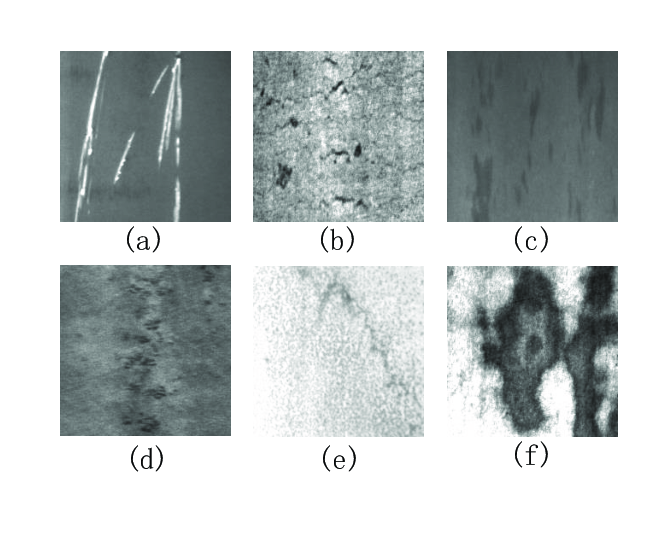
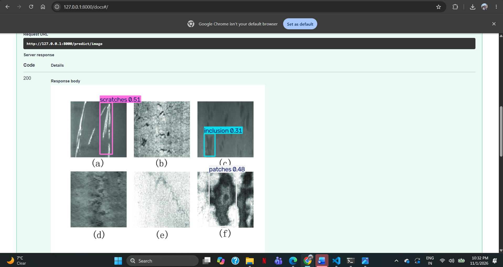

# Computer Vision Demo for Manufacturing Quality Inspection

## 1. Project Overview

This project demonstrates how computer vision and deep learning can be applied to automated visual quality inspection in manufacturing.

It was developed as a technical proof-of-concept to support a manufacturing improvement proposal exploring the use of AI to identify visual defects earlier in the production process.

The overall aim is to investigate how computer vision could help identify defects consistently, reduce the amount of manual inspection required, minimise downstream rework and support manufacturing quality teams.

The project combines a YOLOv8 object detection model with a FastAPI backend, allowing users to upload images, receive defect predictions and view images with detected defects highlighted.

## 2. Background and Manufacturing Application

In manufacturing, defects identified at later stages of production can lead to additional inspection, rework and lost production time.

My manufacturing experience in quality inspection helped me identify opportunities where computer vision could potentially support earlier defect detection.

The proposed approach is to introduce an automated visual inspection step after assembly and before selected downstream production processes.

A computer vision system could:

- Identify selected visual defects at an earlier production stage.
- Support inspectors by highlighting potential defects.
- Improve consistency in visual inspection.
- Help reduce avoidable downstream rework.
- Provide a foundation for data-driven quality improvement.

Computer vision would complement existing inspection procedures rather than replace essential manual, electrical or functional testing.

## 3. Proof-of-Concept Implementation

To demonstrate the technical approach, I developed an object detection model using the publicly available NEU-DET steel surface defect dataset.

**Important:** The current model is trained on steel surface defect images. It does not use actual my company or other proprietary manufacturing product images. It demonstrates the computer vision workflow and provides a starting point for further investigation using appropriately collected and labelled manufacturing images.

### Technologies Used

- Python
- YOLOv8 (Ultralytics)
- OpenCV
- FastAPI
- Uvicorn
- PyTorch
- VS Code
- Git and GitHub

## 4. Dataset and Defect Categories

The NEU-DET dataset contains six steel surface defect categories:

| Class ID | Defect Category |
|---|---|
| 0 | Crazing |
| 1 | Inclusion |
| 2 | Patches |
| 3 | Pitted Surface |
| 4 | Rolled-in Scale |
| 5 | Scratches |

Dataset source: [NEU Surface Defect Database – Kaggle](https://www.kaggle.com/datasets/kaustubhdikshit/neu-surface-defect-database)

The dataset was prepared in YOLO annotation format, using normalised bounding-box coordinates.

The dataset and its annotations are not included in this repository. Please check the dataset's licence and terms before downloading or using it.

## 5. Model Training and Evaluation

The YOLOv8 Nano model was trained to detect and classify the six defect categories.

The following metrics were obtained during evaluation:

| Evaluation Metric | Result |
|---|---:|
| Precision | 76.32% |
| Recall | 54.45% |
| mAP@50 | 65.29% |
| mAP@50-95 | 33.42% |

### Understanding the Results

- **Precision:** 76.32% of the model's predicted detections were correct.
- **Recall:** 54.45% of the labelled defects were detected by the model.
- **mAP@50:** Measures detection performance using an Intersection over Union (IoU) threshold of 0.50.
- **mAP@50-95:** Measures performance across multiple IoU thresholds, from 0.50 to 0.95.

These results represent an initial proof-of-concept, not production-ready performance. In particular, the recall result indicates that the model missed a considerable proportion of labelled defects.

Further improvements, testing on unseen images and investigation of false negatives would be necessary before considering any real manufacturing application.

## 6. Image Prediction

A prediction script was developed to load the trained model and perform inference on new images.

The model identifies potential defects, assigns a class and confidence score, and generates an annotated image showing the detected bounding boxes.

New prediction images do not require YOLO annotation files.

## 7. FastAPI Integration

To make the model accessible through an API, I integrated it with FastAPI.

The API allows users to upload an image and receive model predictions.

### Available Endpoints

| Method | Endpoint | Purpose |
|---|---|---|
| GET | `/` | Basic API welcome message |
| GET | `/health` | Check API availability |
| POST | `/predict` | Upload an image and receive defect predictions in JSON |
| POST | `/predict/image` | Upload an image and receive an annotated image |

The prediction response can include:

- Uploaded filename
- Total number of detected defects
- Predicted defect category
- Confidence score
- Bounding-box coordinates

### API Documentation

FastAPI provides interactive API documentation through Swagger UI, allowing users to test the endpoints directly.

After starting the application, visit:

`http://127.0.0.1:8000/docs`

## 8. Screenshots

### Sample Input Image



### YOLOv8 Detection Output



### FastAPI Swagger Documentation


### API Prediction


## 9. Project Setup and Execution

### Prerequisites

- Python 3.11
- Git
- VS Code (recommended)

### Step 1: Clone the Repository

```bash
git clone https://github.com/rohith177/Computer_Vision_detection.git
cd Computer_Vision_detection
```

### Step 2: Create a Virtual Environment

```bash
python -m venv .venv
```

Activate it on Windows PowerShell:

```powershell
.\.venv\Scripts\Activate.ps1
```

### Step 3: Install Dependencies

```bash
pip install ultralytics fastapi uvicorn python-multipart opencv-python
```

### Step 4: Prepare the Dataset

Download the NEU-DET dataset from its original source and prepare the images and YOLO-format annotations.

Create the training and validation folders expected by your training configuration.

Create a local `data.yaml` file containing the dataset paths and six class names.

The dataset configuration file is excluded from this repository because it contains local paths.

### Step 5: Train the Model

Run the training script:

```bash
python train.py
```

The trained model weights will be generated in the training output directory.

### Step 6: Configure the Model Path

Place your trained `best.pt` file in the location expected by `app/main.py`, or update `MODEL_PATH` in that file to point to your trained weights.

The model weights are not included in this repository.

### Step 7: Start the FastAPI Application

From the project root:

```bash
uvicorn app.main:app --reload
```

Open the interactive API documentation:

`http://127.0.0.1:8000/docs`

You can now upload an image and test the prediction endpoints.

## 10. Current Limitations

This project is an initial technical demonstration and has several limitations:

- The model was trained using steel surface defect images rather than actual manufacturing product images.
- The current recall indicates that some defects are missed.
- The model has not been validated in a live manufacturing environment.
- Production deployment would require appropriate camera positioning, controlled lighting, representative image data and further testing.
- The current API demonstrates model integration but does not provide a complete industrial inspection system.

## 11. Future Development

Potential next steps include:

1. Collecting and labelling representative manufacturing images, subject to employer permission.
2. Training and evaluating a model on the specific visual defects relevant to the intended manufacturing application.
3. Improving recall while controlling false-positive detections.
4. Testing suitable industrial cameras and fixed lighting conditions.
5. Integrating the model into a practical inspection workflow.
6. Evaluating the effect on inspection time, rework and production efficiency.
7. Exploring database integration, deployment and monitoring.

## 12. Key Learning Outcomes

Through this project, I gained practical experience in:

- Preparing image datasets and YOLO-format annotations.
- Training and evaluating an object detection model.
- Understanding precision, recall and mean Average Precision.
- Performing image inference using YOLOv8.
- Processing images using OpenCV.
- Building REST API endpoints using FastAPI.
- Returning prediction results as JSON and annotated images.
- Managing project files and version control using Git and GitHub.
- Connecting AI development with practical manufacturing quality improvement.

## Author

**Rohith Thampan**

MSc Artificial Intelligence | Manufacturing Quality Inspection | Computer Vision

GitHub: [rohith177](https://github.com/rohith177)

---

*This project is an independent technical proof-of-concept exploring computer vision for manufacturing quality inspection. It does not represent an approved or deployed production system.*